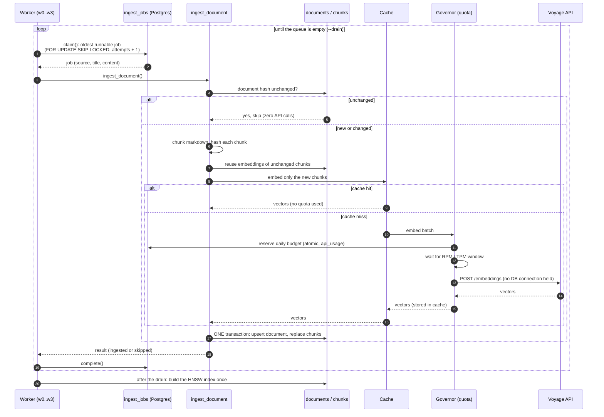

# fastapi-docs-rag

A retrieval-augmented generation (RAG) system over the FastAPI documentation: it ingests the docs,
answers questions with citations to the pages it used, and says "I can't tell from these docs" when
the answer is not there. Its real subject is the failure case:
**what happens when the first retrieval pass is not enough, and how do you know it got better?**

## About

**Context.** Most RAG demos stop the moment a question gets a plausible answer. The interesting
engineering starts after that: loading tens of thousands of documents without duplicating work or
losing jobs, noticing that the retrieved passages do not actually answer the question, trying again
in a controlled way, and proving with numbers that each change helped. The FastAPI docs make a good
test bed: public, well written, small enough to run on a laptop, and familiar enough that I can tell a
good answer from a confident wrong one. Four of the eval questions are deliberately unanswerable from
those docs, so the correct behavior is to abstain.

**Goal.** Build a small but honest end-to-end system: queue-based, idempotent ingestion that could
scale to something like 50,000 documents an hour; retrieval with citations; an agent loop that grades
whether the evidence is sufficient and then rewrites, decomposes or widens the search under hard caps;
and an evaluation harness so every step is measured against the last one instead of judged by feel.

**Motivation.** I am a full-stack engineer learning agentic patterns by building one, and I wanted a
project where the design decisions (queues, retries, idempotency, cost and rate limits, evaluation)
are as visible as the model calls. It also runs entirely on free API tiers (Voyage for embeddings,
Groq for answers), which turned quota handling into part of the design instead of an afterthought.

> Status: Phase 1 is done (queue-based ingestion, baseline vector RAG, eval harness, quota-safe
> providers). Phase 2 (hybrid search + reranking) and Phase 3 (the agent loop) are next. Numbers below
> come only from saved runs in `evals/results/`; empty cells mean "not measured yet".

## Documentation

If you want the big picture first, start with [Architecture](docs/architecture.md): it has the system
diagram, explains how the embedding and chat providers can be swapped independently, and lays out the
three retrieval phases and the plan for the agent loop. The part I would most like you to read is
[Ingestion design](docs/ingestion.md), which covers why a Postgres queue is enough at this scale, how
retries, dead-lettering and idempotency work, and the throughput math behind the 50,000-documents-an-hour
target (the sequence diagrams for it are further down this page). Because free tiers shape so much of
the design, [API quotas](docs/quotas.md) explains the rate limiter, the daily budget, the disk cache and
how a run pauses and resumes instead of failing.

When you want to run things, [Make commands](docs/commands.md) walks through every `make` target in the
order you would use them, what each one needs first, and the pre-commit hook that blocks a commit on
lint errors, failing tests or a leaked key. To understand the numbers, [Evaluation method](docs/evaluation.md)
describes the 21 questions, the metrics and the rules for what may appear in the results table, and
[Tests and coverage](docs/testing.md) covers the test suite and the 90% coverage gate.

## Quickstart

You need Docker, [uv](https://docs.astral.sh/uv/), and free API keys: Voyage AI (embeddings) and
Groq (chat). Put the keys in `.env` only, never in chat, issues or commits.

```bash
cp .env.example .env            # then add VOYAGE_API_KEY and GROQ_API_KEY
make up                         # Postgres 16 + pgvector on :5433
make init                       # create tables (once per fresh database)
make corpus                     # fetch the FastAPI docs (markdown) into ./corpus
make enqueue-dev && make worker # queue a 40-doc subset and embed it (or `make enqueue` for all 147)
make api                        # http://localhost:8000/docs
curl -s localhost:8000/ask -H 'content-type: application/json' \
  -d '{"question":"How do I run code at startup and shutdown?"}' | jq
make eval                       # retrieval metrics on the 21 eval questions
```

No API keys? `PROVIDER=fake` runs everything offline (plumbing only, not quality).
Providers and models are chosen in `.env`; see [Architecture > Providers](docs/architecture.md#providers).
Free tiers are slow: read [API quotas](docs/quotas.md) before a big ingest.

**Check your keys before ingesting** (two real calls, after `make up && make init`):

```bash
uv run python - <<'EOF'
import asyncio
from app.providers import get_embedder, get_llm
async def main():
    v = await get_embedder().embed(["hello"], kind="query")
    print("embed ok, dim:", len(v[0]))
    r = await get_llm().generate("Say OK.")
    print("llm ok:", r.text, r.input_tokens, r.output_tokens)
asyncio.run(main())
EOF
```

Troubleshooting:
- `EMBED_DIM ... got 768`: Voyage needs `EMBED_DIM=1024`. If `.env` already says so, a variable
  exported in your shell wins over `.env`: check `env | grep -E "EMBED|LLM_|PROVIDER"` and `unset` it.
- `relation "api_usage" does not exist`: run `make init`.
- Changing embedding model or `EMBED_DIM` needs a fresh database (`docker compose down -v`).
- A 400 from Voyage or Groq usually means a wrong model name; the response body is in the error.
- `make eval` looks stuck: with a low `EMBED_RPM` it waits between questions and logs the wait.

## How ingestion works

Workers pull jobs from a Postgres queue; each job is one document. The first diagram is the normal
path, the second shows what happens when something goes wrong. Why it is built this way, and the
throughput math, are in [Ingestion design](docs/ingestion.md).

### Happy path

Several workers run this loop in parallel against the same queue:



### Failure paths

Each one is handled per job, so one bad document never stops the run:

```mermaid
sequenceDiagram
    autonumber
    participant W as Worker
    participant Q as ingest_jobs (Postgres)
    participant G as Governor (quota)
    participant V as Voyage API

    rect rgb(0, 0, 0)
    Note over W,V: A. Transient error (5xx, timeout)
    W->>G: embed batch
    G->>V: POST /embeddings
    V--xG: 503
    G->>V: retry with exponential backoff + jitter
    V-->>G: vectors (the job carries on)
    end

    rect rgb(0, 0, 0)
    Note over W,Q: B. Job keeps failing
    W->>Q: fail(): status pending, run_after = now + backoff with jitter
    Q-->>W: another worker (or this one) picks it up later
    W->>Q: after JOB_MAX_ATTEMPTS: status failed (dead letter, last_error kept)
    end

    rect rgb(0, 0, 0)
    Note over W,Q: C. Worker crashes mid-job
    W--xQ: process dies, job stays running
    Q->>Q: lock older than the visibility timeout counts as claimable again
    Q-->>W: claim() hands it to a live worker (the attempt still counts)
    end

    rect rgb(0, 0, 0)
    Note over W,V: D. Quota hit: a pause, not a failure
    W->>G: embed batch
    G->>Q: reserve daily budget: limit reached
    G--xW: QuotaExhausted (no network call made)
    W->>Q: release(): back to pending until the reset, attempt NOT burned
    W->>W: set stop, all workers exit cleanly
    Note over G,V: An unexpected 429 waits out the minute window once (65 s),<br/>a second 429 marks the day exhausted and follows the same path
    end
```



## Reading the results

How the metrics are defined, and how to run an eval, is in [Evaluation method](docs/evaluation.md).
In short: **hit@5** asks "did retrieval find a right document", **full_recall@5** asks "did it find
*all* the documents a multi-part question needs", **MRR** rewards ranking the right one first, and the
LLM-based columns (cited, abstain, tokens, latency) need `make eval-gen`.

**Run 1: vector only, retrieval only, dev subset (40 docs).** Saved as `evals/results/vector-1791725096.json`.
The 40 docs are the ones the questions point at plus distractors, so this is the easy case:

| Configuration | hit@5 | full_recall@5 | MRR | cited_ok | abstain (unanswerable) | tokens/query | latency |
|---|---|---|---|---|---|---|---|
| Vector only (40 docs, retrieval) | 1.00 (17/17) | 0.94 (16/17) | 0.97 | not run | not run | not run | not run |
| Vector only (147 docs) | | | | | | | |
| + hybrid (RRF) | | | | | | | |
| + rerank | | | | | | | |
| + agent loop | | | | | | | |

hit@5, full_recall@5 and MRR are over the 17 answerable questions. "not run" means that run did not
call the LLM.

**How much to trust this.** 21 questions is a smoke test, not a benchmark, and a difference of one
question is noise. With only 40 documents the retriever has little to confuse, so a 1.00 hit rate
mostly says the plumbing works and the questions are reasonable; the real comparison starts on the
full corpus, where hybrid search and reranking have something to fix.

### Known failure modes

- **Multi-hop question q16 gets only half the evidence** (the only miss in run 1). It needs
  `dependencies-with-yield.md` and `background-tasks.md`; the top 5 chunks came from
  `advanced-dependencies.md` and `dependencies-with-yield.md`, so `background-tasks.md` never
  reached the model. One query vector favors the dominant half of a two-part question, and top-k
  chunks cluster in a few documents. Expected fix: the agent loop's *decompose* step (retrieve each
  sub-question separately), possibly diversity-aware ranking. Not tried yet.
- **Unanswerable questions (q18 to q21) are not scored yet.** Retrieval returns something for
  every query (often `index.md`), so abstention depends entirely on the LLM and the sufficiency
  grader. Needs a `make eval-gen` run.

_More to be added from real runs on the full corpus._

## Limits and what I would do next

- Free-tier APIs: rate limits apply, and providers may use free-tier data to improve their products
  (public docs only here).
- Measured ingest throughput on the full corpus is still pending.
- Chunks under 200 chars are 12% of the corpus; merging tiny sections into neighbors may help.
- Contextual retrieval (LLM-written context prepended to each chunk) is a likely next gain.
- Production: tracing (Langfuse/LangSmith), drift monitoring on the eval set in CI, per-query
  cost budgets, and a real queue.
