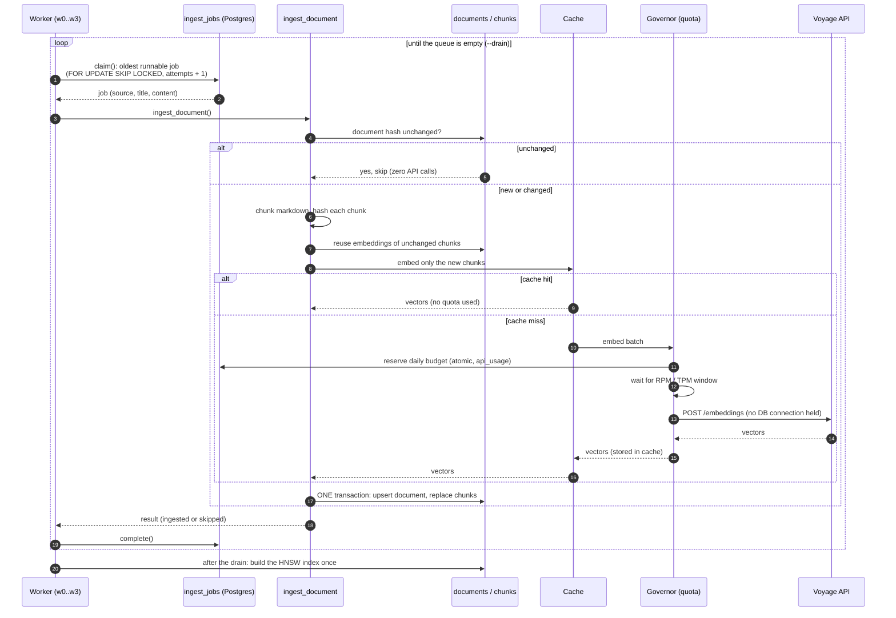

# fastapi-docs-rag

A retrieval-augmented generation (RAG) system over the FastAPI documentation: it ingests the docs,
answers questions with citations to the pages it used, and says "I can't tell from these docs" when
the answer is not there. Its real subject is the failure case:
**what happens when the first retrieval pass is not enough, and how do you know it got better?**

## About

**Context.** Most RAG demos stop the moment a question gets a plausible answer. The interesting
engineering starts after that: loading tens of thousands of documents without duplicating work or
losing jobs, noticing that the retrieved passages do not actually answer the question, trying again
in a controlled way, and proving with numbers that each change helped. The FastAPI docs make a good
test bed: public, well written, small enough to run on a laptop, and familiar enough that I can tell a
good answer from a confident wrong one. Four of the eval questions are deliberately unanswerable from
those docs, so the correct behavior is to abstain.

**Goal.** Build a small but honest end-to-end system: queue-based, idempotent ingestion that could
scale to something like 50,000 documents an hour; retrieval with citations; an agent loop that grades
whether the evidence is sufficient and then rewrites, decomposes or widens the search under hard caps;
and an evaluation harness so every step is measured against the last one instead of judged by feel.

**Motivation.** I am a full-stack engineer learning agentic patterns by building one, and I wanted a
project where the design decisions (queues, retries, idempotency, cost and rate limits, evaluation)
are as visible as the model calls. It also runs entirely on free API tiers (Voyage for embeddings,
Groq for answers), which turned quota handling into part of the design instead of an afterthought.

> Status: Phase 1 is done (queue-based ingestion, baseline vector RAG, eval harness, quota-safe
> providers). Phase 2 is built and measured: reranking helped, hybrid search did not (see Phase 2
> results). Phase 3 (the agent loop, LangGraph) is built and tested offline; its eval row is empty
> until a real run. Numbers below come only from
> saved runs in `evals/results/`; empty cells mean "not measured yet".

## Documentation

If you want the big picture first, start with [architecture](docs/architecture.md): it has the system
diagram, explains how the embedding and chat providers can be swapped independently, and lays out the
three retrieval phases and the plan for the agent loop. The part I would most like you to read is
[ingestion design](docs/ingestion.md), which covers why a Postgres queue is enough at this scale, how
retries, dead-lettering and idempotency work, and the throughput math behind the 50,000-documents-an-hour
target (the sequence diagrams for it are further down this page). Because free tiers shape so much of
the design, [API quotas](docs/quotas.md) explains the rate limiter, the daily budget, the disk cache and
how a run pauses and resumes instead of failing.

When you want to run things, [make commands](docs/commands.md) walks through every `make` target in the
order you would use them, what each one needs first, and the pre-commit hook that blocks a commit on
lint errors, failing tests or a leaked key. To understand the numbers, [evaluation method](docs/evaluation.md)
describes the 21 questions, the metrics and the rules for what may appear in the results table, and
[tests and coverage](docs/testing.md) covers the test suite and the 90% coverage gate.

## Quickstart

You need Docker, [uv](https://docs.astral.sh/uv/), and free API keys: Voyage AI (embeddings) and
Groq (chat). Put the keys in `.env` only, never in chat, issues or commits.

```bash
cp .env.example .env            # then add VOYAGE_API_KEY and GROQ_API_KEY
make up                         # Postgres 16 + pgvector on :5433
make init                       # create tables (once per fresh database)
make corpus                     # fetch the FastAPI docs (markdown) into ./corpus
make enqueue-dev && make worker # queue a 40-doc subset and embed it (or `make enqueue` for all 147)
make api                        # http://localhost:8000/docs
curl -s localhost:8000/ask -H 'content-type: application/json' \
  -d '{"question":"How do I run code at startup and shutdown?"}' | jq
make eval                       # retrieval metrics on the 21 eval questions
```

No API keys? `PROVIDER=fake` runs everything offline (plumbing only, not quality).
Providers and models are chosen in `.env`; see [Architecture > Providers](docs/architecture.md#providers).
Free tiers are slow: read [API quotas](docs/quotas.md) before a big ingest.

**Check your keys before ingesting** (two real calls, after `make up && make init`):

```bash
uv run python - <<'EOF'
import asyncio
from app.providers import get_embedder, get_llm
async def main():
    v = await get_embedder().embed(["hello"], kind="query")
    print("embed ok, dim:", len(v[0]))
    r = await get_llm().generate("Say OK.")
    print("llm ok:", r.text, r.input_tokens, r.output_tokens)
asyncio.run(main())
EOF
```

Troubleshooting:
- `EMBED_DIM ... got 768`: Voyage needs `EMBED_DIM=1024`. If `.env` already says so, a variable
  exported in your shell wins over `.env`: check `env | grep -E "EMBED|LLM_|PROVIDER"` and `unset` it.
- `relation "api_usage" does not exist`: run `make init`.
- Changing embedding model or `EMBED_DIM` needs a fresh database (`docker compose down -v`).
- A 400 from Voyage or Groq usually means a wrong model name; the response body is in the error.
- `make eval` looks stuck: with a low `EMBED_RPM` it waits between questions and logs the wait.

## How ingestion works

Workers pull jobs from a Postgres queue; each job is one document. The first diagram is the normal
path, the second shows what happens when something goes wrong. Why it is built this way, and the
throughput math, are in [Ingestion design](docs/ingestion.md).

### Happy path

Several workers run this loop in parallel against the same queue:



### Failure paths

Each one is handled per job, so one bad document never stops the run:

```mermaid
sequenceDiagram
    autonumber
    participant W as Worker
    participant Q as ingest_jobs (Postgres)
    participant G as Governor (quota)
    participant V as Voyage API

    rect rgb(0, 0, 0)
    Note over W,V: A. Transient error (5xx, timeout)
    W->>G: embed batch
    G->>V: POST /embeddings
    V--xG: 503
    G->>V: retry with exponential backoff + jitter
    V-->>G: vectors (the job carries on)
    end

    rect rgb(0, 0, 0)
    Note over W,Q: B. Job keeps failing
    W->>Q: fail(): status pending, run_after = now + backoff with jitter
    Q-->>W: another worker (or this one) picks it up later
    W->>Q: after JOB_MAX_ATTEMPTS: status failed (dead letter, last_error kept)
    end

    rect rgb(0, 0, 0)
    Note over W,Q: C. Worker crashes mid-job
    W--xQ: process dies, job stays running
    Q->>Q: lock older than the visibility timeout counts as claimable again
    Q-->>W: claim() hands it to a live worker (the attempt still counts)
    end

    rect rgb(0, 0, 0)
    Note over W,V: D. Quota hit: a pause, not a failure
    W->>G: embed batch
    G->>Q: reserve daily budget: limit reached
    G--xW: QuotaExhausted (no network call made)
    W->>Q: release(): back to pending until the reset, attempt NOT burned
    W->>W: set stop, all workers exit cleanly
    Note over G,V: An unexpected 429 waits out the minute window once (65 s),<br/>a second 429 marks the day exhausted and follows the same path
    end
```



## Reading the results

How the metrics are defined, and how to run an eval, is in [Evaluation method](docs/evaluation.md).
In short: **hit@5** asks "did retrieval find a right document", **full_recall@5** asks "did it find
*all* the documents a multi-part question needs", **MRR** rewards ranking the right one first, and the
LLM-based columns (cited, abstain, tokens, latency) need `make eval-gen`.

**Runs so far** (saved in `evals/results/`; Run 1 is kept locally, not pushed):

1. **Dev subset, retrieval only (40 docs).** The 40 docs are the ones the questions point at plus
   distractors, so this is the easy case.
2. **Full corpus, retrieval only (147 docs, 1,161 chunks).** `vector-1791813805.json`.
3. **Full corpus, retrieval + generation with Groq (21 questions).** `vector-gen-1791813768.json`, then again after the citation fix (`vector-gen-1791814944.json`).
4. **Full corpus, hybrid search, retrieval only.** `hybrid-1791820936.json`.
5. **Full corpus, hybrid candidates + Voyage rerank, retrieval only.** `rerank-1791820713.json`.

| Configuration | hit@5 | full_recall@5 | MRR | cited_ok | false_abstain | abstain (unanswerable) | tokens/query | latency |
|---|---|---|---|---|---|---|---|---|
| Vector only, 40 docs (retrieval) | 1.00 (17/17) | 0.94 (16/17) | 0.97 | not run | not run | not run | not run | not run |
| Vector only, 147 docs (retrieval) | 1.00 (17/17) | 0.88 (15/17) | 0.97 | not run | not run | not run | not run | not run |
| Vector only, 147 docs + generation (before citation fix) | 1.00 (17/17) | 0.88 (15/17) | 0.97 | 0.76 (13/17) | 0.06 (1/17) | 1.00 (4/4) | ~1,440 | see note |
| Vector only, 147 docs + generation (after citation fix) | 1.00 (17/17) | 0.88 (15/17) | 0.97 | 0.88 (15/17) | 0.06 (1/17) | 1.00 (4/4) | ~1,600 | see note |
| + hybrid (RRF), retrieval | 1.00 (17/17) | 0.88 (15/17) | **0.73** | not run | not run | not run | not run | not run |
| + rerank (on hybrid candidates), retrieval | 1.00 (17/17) | **0.94 (16/17)** | 0.94 | not run | not run | not run | not run | see note |
| + agent loop (rerank), only q14, q16, q17 | see Phase 3 section | | | | | | ~4,000 | see note |

hit@5, full_recall@5, MRR, cited_ok and false_abstain are over the 17 answerable questions;
abstain is over the 4 unanswerable ones. "not run" means that run did not call the LLM. Tokens per
query is input plus output tokens of the answer call (21,000 in + 9,200 out over 21 questions).
The corpus is 156 markdown files; 9 (release notes, newsletter, contributing, translation banner
and similar) are excluded on purpose, which leaves 147.

**Latency note.** Average latency is 20 s per question, but it is bimodal: most answers take 1 to
2 s and about a third take around 58 s. The slow ones are the client waiting for the Groq
tokens-per-minute window to reopen (8K TPM on the free tier), not the model. Treat the average as a
measure of the free-tier limit, not of the system.

### Phase 2 results: reranking helped, hybrid search did not

Same 21 questions, same 147 documents, same 5 chunks per question; only the retriever changed.

| Retriever | hit@5 | full_recall@5 | MRR | Questions whose first right document moved |
|---|---|---|---|---|
| Vector (baseline) | 1.00 | 0.88 | 0.97 | none |
| Hybrid (vector + full-text, RRF) | 1.00 | 0.88 | **0.73** | 7 of 17 moved down: q02 (1 to 3), q05 (1 to 2), q07 (1 to 4), q11 (1 to 3), q12 (1 to 2), q15 (1 to 2), q17 (1 to 2) |
| Rerank (hybrid top 20, Voyage `rerank-2.5-lite`) | 1.00 | **0.94** | 0.94 | 1: q11 (1 to 2) |

- **Hybrid search made ranking worse and recovered nothing.** It found the same documents as
  the vector search (hit and full recall unchanged; q14 and q16 still miss) but pushed the right
  one down on 7 questions. My hypothesis, not yet tested: the keyword half ORs every word of the
  question, Postgres ranks without IDF, and so generic words like "use", "app" or "FastAPI" put
  broad pages (`versions.md`, `fastapi-cli.md`, `bigger-applications.md`) at the top of the keyword
  list. Reciprocal Rank Fusion gives that list the same weight as the vector list, so the noise
  outranks a correct vector hit. This is a flaw of this implementation, not proof that hybrid
  search cannot help; questions with exact identifiers are the case it is meant for, and this
  question set has few.
- **Reranking fixed q14 and cost one rank on q11.** q14 now returns both documents it needs
  (`testing-dependencies.md` and `testing.md`), so full recall rose from 15 to 16 of 17. On q11 the
  reranker put `reference/staticfiles.md` above `tutorial/static-files.md`; the right document is
  still in the top 5, so hit@5 is unaffected, but MRR dropped from 0.97 to 0.94. The reranker also
  recovered from the noisy hybrid ordering, because it rescored all 20 candidates rather than
  trusting their order.
- **q16 is still not fixed by either, and the reason is the reranker's choice, not the search.**
  `background-tasks.md` is among the 20 hybrid candidates (checked offline, see below), but the
  reranker scored five chunks from `advanced-dependencies.md` and `dependencies-with-yield.md`
  above it. One question about two topics gets answered with the more dominant topic. That is what
  the agent loop's decompose step is for: search each half separately.
- **Reranking is slow on the free tier.** The retrieval stage took about 60 s per question (21
  questions in about 20 minutes), because the local limiter waits between rerank requests; the model
  call itself is quick. The likely cause is the token estimate (3 characters per token, deliberately
  high) making each 20-candidate request look large against the assumed 10K tokens per minute. I
  have not confirmed Voyage's actual rerank limits.
- **Not measured:** answer quality with the new retrievers (`make eval-gen MODE=rerank`).

**Offline experiments (no API calls).** To tune the hybrid search without spending quota,
`experiments/phase2_offline.py` rebuilds the corpus in a throwaway Postgres using the real Voyage
vectors from the disk cache. It reproduces the saved runs exactly (vector 0.882 / 0.971, hybrid
0.882 / 0.730), so its other rows can be trusted. Reranking cannot be tested this way.

| Variant (top 5 chunks) | full_recall@5 | MRR |
|---|---|---|
| Vector | 0.88 | **0.97** |
| Hybrid, keyword list weight 1.0 (shipped) | 0.88 | 0.73 |
| Hybrid, keyword weight 0.5 / 0.15 | 0.88 | 0.79 / 0.84 |
| Hybrid, drop words found in more than 10% of chunks, weight 0.5 | 0.94 | 0.84 |
| Hybrid, drop words found in more than 2% of chunks | 0.82 | 0.93 |
| Hybrid, keywords only from code-like identifiers | 0.82 | 0.90 to 0.93 |

| Candidate pool for the reranker (top 20 chunks) | Both needed documents present |
|---|---|
| Vector | 16 of 17 (misses q16) |
| Hybrid, keyword weight 1.0 (shipped) | **17 of 17** |
| Hybrid, keyword weight 0.5 or lower | 16 of 17 |
| Hybrid at depth 10 or 15 | 16 of 17 |

What this decides: no hybrid variant beats plain vector search on ranking for these questions
(vector is already at 0.97 MRR), and the variants that raise MRR do it by dropping keywords, which
costs full recall. But the shipped hybrid is the best *candidate generator*: its top 20 contains
every needed document, which vector search alone does not. So hybrid stays as the first stage of
`rerank` and is not recommended as a standalone mode. The caveat is the same as everywhere here:
21 questions, so these are directions, not tunings I would defend to the second decimal. I did not
add the document-frequency filter: it needs corpus statistics that get expensive on a large table.
- **Reading the size of these effects.** One question is 0.06 of full recall, so +0.06 from
  reranking is a single question. Hybrid's MRR drop (0.97 to 0.73) is larger and consistent across
  7 questions, so I trust that one more than the recall gain.

**How much to trust this.** 21 questions is a smoke test, not a benchmark, and a difference of one
question is noise. Moving from 40 to 147 documents cost one question of full recall (0.94 to 0.88),
which is the effect you expect when distractors are added and the reason Phase 2 was built. hit@5 and MRR did not move, so the first right document is still found and
ranked first; what gets lost is the second document of a multi-part question.

### Phase 3 first results: the loop works, but three questions cannot prove it helps

Run: `agent-rerank-gen-1791822263.json`, the rerank retriever plus the agent loop, on the three
known failures only (q14, q16, q17), to stay inside Groq's daily token cap. It is not comparable
to the 21-question rows above, and there is no unanswerable question in it, so ignore its abstain
figure.

| Question | Vector + generation (before) | Agent + rerank (after) | Rounds, stop reason | Tokens |
|---|---|---|---|---|
| q14 (multi: override a dependency + create the test client) | full recall missed, answer cited a right doc | both documents, cited | 1, sufficient | 2,642 (vector: 1,461) |
| q16 (multi: yield dependency + background tasks) | missed `background-tasks.md` | still missed `background-tasks.md` | 1, sufficient (the grader was wrong) | 4,348 (vector: 3,183) |
| q17 (partial: Celery) | **false abstain** | answered the part the docs cover, "Not found:" for the rest, cited | 3, max_rounds | 5,014 (vector: 1,813) |

Average 4,001 tokens per question against about 1,600 for Phase 1, and 1.67 rounds.

- **q14 is a retrieval win, not an agent win.** Reranking fixed it in Phase 2; the loop only
  confirmed the evidence was enough (one extra grading call).
- **q16 is the loop's failure, and the reason is informative.** The grader judged the evidence
  sufficient because the passages from `dependencies-with-yield.md` do discuss background tasks
  (the version note about when exit code runs). It could not know that a separate document is the
  authority on background tasks. The decompose step never ran, so it never got the chance to fix
  the case it was built for.
- **q17 went from a false abstain to a useful partial answer, but the loop was wasteful.** The
  grader asked for "Celery integration", "Celery worker setup", then "Celery FastAPI integration
  setup": rewordings of one query. The docs simply do not cover Celery setup, so the extra rounds
  found one and then two new chunks (the last two from `tutorial/index.md` and `deployment/docker.md`,
  unrelated) and cost about 3,300 more tokens and 3 minutes. I cannot say how much of the better answer
  comes from the loop and how much from the larger context (8 passages instead of 5); that would
  need a rerank-plus-generation run without the loop.
- **Not shown:** whether the loop hurts questions that were already fine. That needs the full
  21-question run.

**Changes made after this run (not yet measured):** (1) the loop now stops when a follow-up round
brings no document that no earlier round had returned; on q17 this would have ended it after round 2.
(2) The grader must list the parts of the question and the passage covering each, and the parser
overrides `sufficient` when a part has none (a passage only counts if it is about the part). Both
come from one run of three questions, so treat them as hypotheses until `make eval-agent` is re-run.

### Known failure modes

- **Multi-hop questions get only half the evidence (q14 and q16, the two full-recall misses).**
  q16 needs `dependencies-with-yield.md` and `background-tasks.md`; the top chunks came from
  `advanced-dependencies.md` and `dependencies-with-yield.md`, so `background-tasks.md` never
  reached the model. q14 needs `testing-dependencies.md` and `testing.md`; on the full corpus
  `advanced/settings.md` took the second slot, and q14 was the question that regressed from the
  40-doc run (reranking fixes it, see Phase 2 results; q16 remains). One query vector favors the dominant half of a two-part question, and top-k chunks
  cluster in a few documents. Expected fix: the agent loop's *decompose* step (retrieve each
  sub-question separately), possibly diversity-aware ranking. Not tried yet.
- **Unanswerable questions are refused correctly (q18 to q21, 4/4).** Retrieval still returns
  something for every query (often `index.md`, `features.md`), so the refusal comes entirely from
  the LLM saying `INSUFFICIENT_CONTEXT`. With four questions this says the prompt works, not that
  abstention is solved; a sufficiency grader is still planned.
- **One false abstain (q17).** "Set up Celery workers with FastAPI" is a partial question: the docs
  mention Celery only in passing. The model refused outright instead of answering what the docs do
  say. Whether that is right or wrong depends on the policy we want; today the metric counts it
  against the system.
- **Citation misses were mostly a format problem, now fixed (q07, q10).** q07 gave a correct
  answer but cited with `【5】` instead of `[5]`, and q10 declined to use the retrieved text and
  cited nothing. A lenient citation parser (accepts `【5】`, `[2, 5]`) and a tighter prompt (plain
  `[n]`, a citation required on partial answers, "read the code examples", "Not found" only for
  what is truly absent) lifted `cited_ok` from 0.76 to 0.88 with retrieval unchanged. What remains
  is q16 (it cites only the one of its two documents that was retrieved, a retrieval problem) and
  q17 (the false abstain above). q14's answer now says "Not found: how to create the test client",
  which is the honest way for a missing second document to show up.

_More to be added from real runs of hybrid search, reranking and the agent loop._

## Limits and what I would do next

- Free-tier APIs: rate limits apply, and providers may use free-tier data to improve their products
  (public docs only here).
- Ingest throughput on the free tier is limited by the embedding quota (3 requests per minute), not by the pipeline. `make load-test` measures the pipeline alone: about 70 docs/s per process with a fake embedder (details in [Ingestion](docs/ingestion.md#pipeline-throughput-load-test)). That excludes real network behavior and a 395k-chunk table, which are not measured.
- Chunks under 200 chars are 12% of the corpus; merging tiny sections into neighbors may help.
- Contextual retrieval (LLM-written context prepended to each chunk) is a likely next gain.
- Production: tracing (Langfuse/LangSmith), drift monitoring on the eval set in CI, per-query
  cost budgets, and a real queue.
