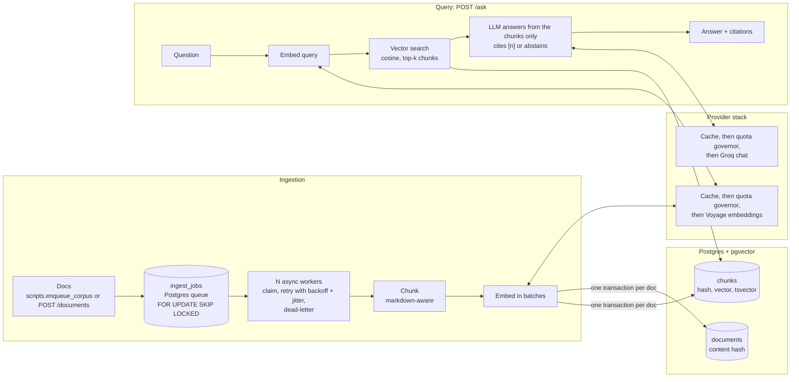

# Architecture



## Providers

Provider interfaces (`app/providers/base.py`) isolate the model vendor, and embeddings and chat are
chosen independently (`EMBED_PROVIDER`, `LLM_PROVIDER`):

| Role | Adapters | Notes |
|---|---|---|
| Embeddings | `voyage`, `gemini`, `fake` | Voyage: `EMBED_DIM` must be 256/512/1024/2048 (use 1024); native query/document types |
| Chat | `groq`, `openai_compat`, `gemini`, `fake` | `openai_compat` covers GitHub Models, OpenRouter, vLLM, Ollama: set base URL, key, model |
| Rerank | `voyage`, `fake` | `rerank-2.5-lite`; same stack as the others (cache, governor with its own `rerank:voyage` counter, HTTP). The governor drops the lowest-ranked candidates if they would not fit a minute of token budget |

Voyage and Groq are the default path. Gemini is supported as a fallback but not benchmarked here.

Every adapter goes through the same stack (cache, then quota governor, then HTTP), with each
provider's own limits preset in `QUOTA_PRESETS` (`app/config.py`) and its own daily counter
(`embed:voyage`, `llm:groq`), so switching vendor never inherits another vendor's usage. Switching
embedding model or dimension means a fresh database (vectors from different models are not comparable).

## Retrieval and the agent loop

Three retrievers share one entry point (`search()` in `app/rag/retrieve.py`), selected by
`RETRIEVAL_MODE` for the API and by `--mode` / `make eval MODE=...` for evals:

| Mode | How it works | Why |
|---|---|---|
| `vector` | embed the question, cosine search over pgvector (HNSW) | the baseline |
| `hybrid` | vector top 20 plus Postgres full-text top 20 (`tsvector`, GIN, OR-style query, `ts_rank_cd`), fused with Reciprocal Rank Fusion (`1/(60+rank)` per list) | exact words and identifiers (`HTTPException`, `response_model_exclude_unset`) that embeddings blur; RRF uses ranks only, so the two score scales need no calibration |
| `rerank` | hybrid top 20, then a cross-encoder (Voyage `rerank-2.5-lite`) rescoring each question and passage together, keeping the top k | the reranker tells a passage that answers the question from one that only shares its topic. Costs one extra request per question |

Known limit of the full-text half: Postgres ranks without IDF, so a very common word counts as much
as a rare one. RRF softens that; a BM25 index (an extension such as ParadeDB's `pg_search`) would
fix it properly at larger scale.

| Phase | Change | Status |
|---|---|---|
| 1 | Vector search over pgvector, cited answers, abstain token | built |
| 2 | Hybrid: Postgres full-text + vector, Reciprocal Rank Fusion, cross-encoder rerank | built and measured: rerank helps, hybrid alone does not (see README) |
| 3 | LangGraph loop: retrieve → grade sufficiency → (rewrite \| decompose \| widen) → retry → answer or abstain | built (LangGraph, `app/rag/agent.py`); real-run results pending |

### The agent loop (Phase 3)

```
START -> retrieve -> grade --sufficient--> answer -> END
            ^          |
            |      insufficient
            |          v
            +------- plan            retrieve -> stop_* (max rounds / no progress / token budget) -> answer
```

- **retrieve** runs the configured retriever (`vector`, `hybrid` or `rerank`) for each pending query.
  Round 1 uses the original question and `k`; later rounds keep `AGENT_PER_QUERY` chunks per query.
- **grade** is one LLM call that reads the evidence and replies with JSON: it lists the distinct
  `parts` of the question with the passage covering each (`null` if none), then
  `{"sufficient", "missing": [sub-queries], "rewrite": "..."}`. A passage covers a part only if it is
  about it; a passing mention does not count. If the model says `sufficient` while a part has no
  passage, the parser overrides it and turns those parts into the queries to search. The parser tolerates prose and code
  fences; a reply it cannot parse is not retried, the loop **fails open** (`grader_error`) and answers
  with what it has.
- **plan** turns the verdict into one action: *decompose* (search each missing part on its own),
  *rewrite* (better wording when nothing specific is missing), *widen* (look deeper for the original
  question, once) or *none* (end). A query already tried is never run again.
- **answer** is Phase 1's `generate_answer`: citations, "Not found:" for the missing parts, or the
  abstain token. The context is built round robin across the retrievals (best hit of each query
  first), up to `k + AGENT_CONTEXT_EXTRA` chunks, so every part of a multi-part question is represented.
- **Hard limits:** `AGENT_MAX_ROUNDS` (3), `AGENT_TOKEN_BUDGET` (12,000 tokens for the grading calls),
  and a follow-up round that brings no document not seen before stops the loop (more chunks from documents already in hand were the same material reworded). The result says why it stopped
  (`stop_reason`) and carries a readable `trace`.

Every call goes through the project's own providers, so the quota governor, the disk cache and the
daily budget apply exactly as before; LangGraph only runs the flowchart. LangSmith tracing is off
unless you set its environment variables yourself.

Cost: a question that is sufficient at once costs one extra LLM call (the grader) on top of Phase 1.
Each extra round adds one retrieval plus one grading call. On Groq's free tier the daily token cap
(about 200K tokens, not modelled by the governor) is the practical limit for a full agent eval, so
run the three known failures first: `make eval-agent MODE=rerank ONLY=q14,q16,q17`.

An earlier plan had a free score-threshold check before the grader. It is not built: reranker and
RRF scores are not comparable across modes, and I had no measurement to set a threshold from.
