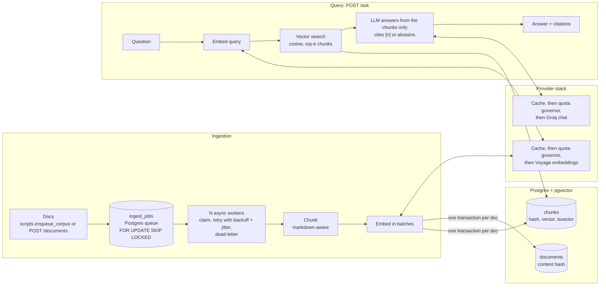

# Architecture

## Providers

Provider interfaces (`app/providers/base.py`) isolate the model vendor, and embeddings and chat are
chosen independently (`EMBED_PROVIDER`, `LLM_PROVIDER`):

| Role | Adapters | Notes |
|---|---|---|
| Embeddings | `voyage`, `gemini`, `fake` | Voyage: `EMBED_DIM` must be 256/512/1024/2048 (use 1024); native query/document types |
| Chat | `groq`, `openai_compat`, `gemini`, `fake` | `openai_compat` covers GitHub Models, OpenRouter, vLLM, Ollama: set base URL, key, model |
| Rerank (Phase 2) | `VoyageReranker` | built and tested, not wired into retrieval yet |

Voyage and Groq are the default path. Gemini is supported as a fallback but not benchmarked here.

Every adapter goes through the same stack (cache, then quota governor, then HTTP), with each
provider's own limits preset in `QUOTA_PRESETS` (`app/config.py`) and its own daily counter
(`embed:voyage`, `llm:groq`), so switching vendor never inherits another vendor's usage. Switching
embedding model or dimension means a fresh database (vectors from different models are not comparable).

## Retrieval and the agent loop

| Phase | Change | Status |
|---|---|---|
| 1 | Vector search over pgvector, cited answers, abstain token | built |
| 2 | Hybrid: Postgres full-text + vector, Reciprocal Rank Fusion, cross-encoder rerank | planned |
| 3 | LangGraph loop: retrieve → grade sufficiency → (rewrite \| decompose \| widen) → retry → answer or abstain | planned |

When a pass is not enough, the plan is to diagnose, not just retry: a cheap score check first
(no LLM call), then a structured sufficiency grader that names the missing sub-questions, then a
targeted action (rewrite for vocabulary mismatch, decompose for multi-part questions, widen
filters for over-narrow retrieval), under hard caps on iterations and tokens. If it still cannot
answer, it answers what it can with citations and says what it could not find.
