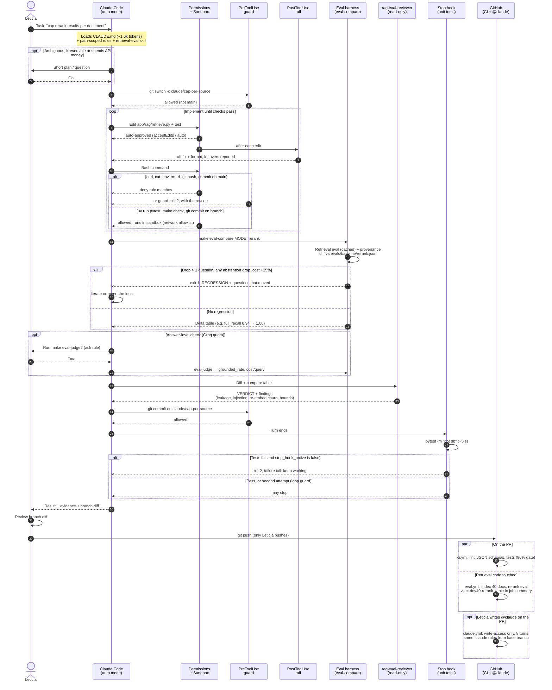

# How the Claude Code harness operates

One retrieval change, end to end: Claude works autonomously on a branch; permissions, hooks, evals and a read-only reviewer decide what is safe; Leticia reviews the branch diff and pushes. Source of truth for each step: `.claude/settings.json`, `.claude/hooks/`, `.claude/agents/`, `evals/compare.py`, `.github/workflows/`.

